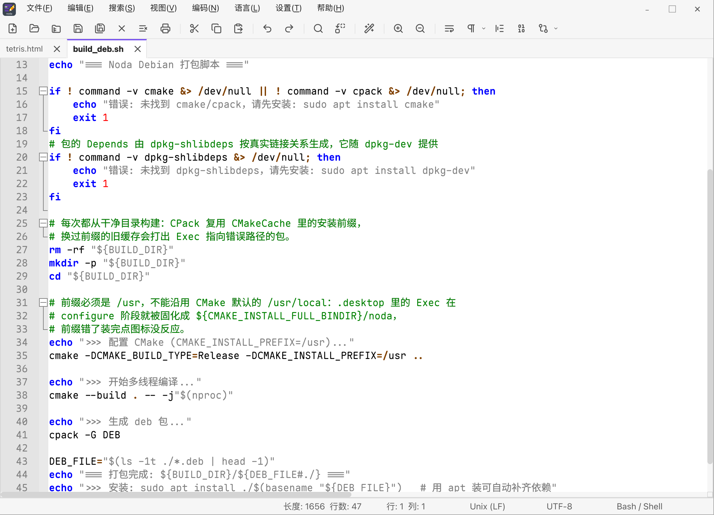
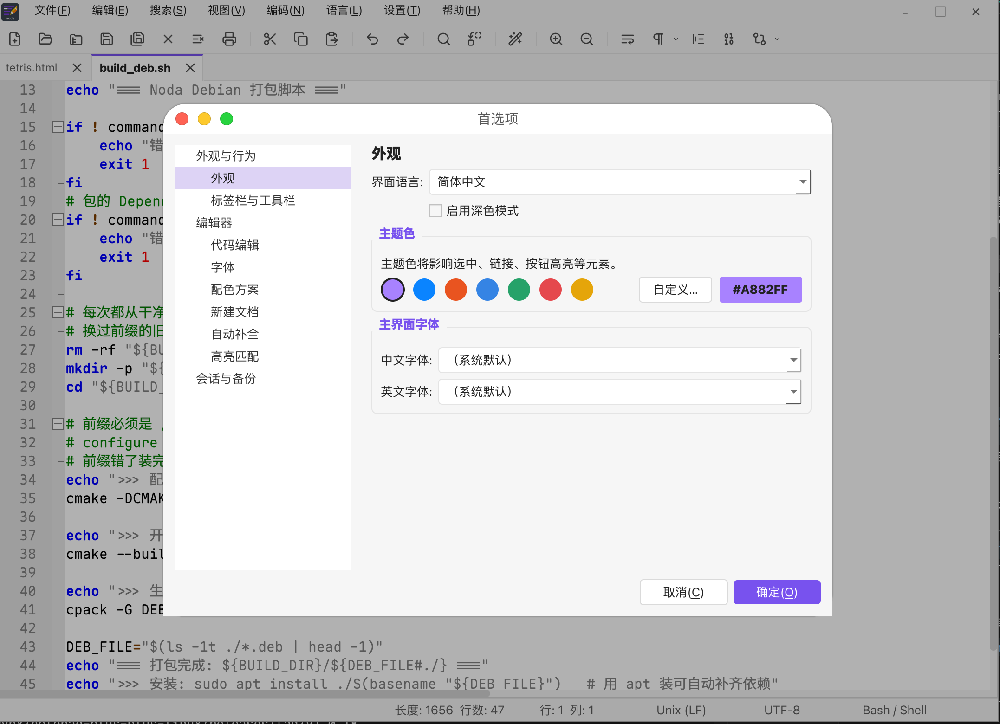
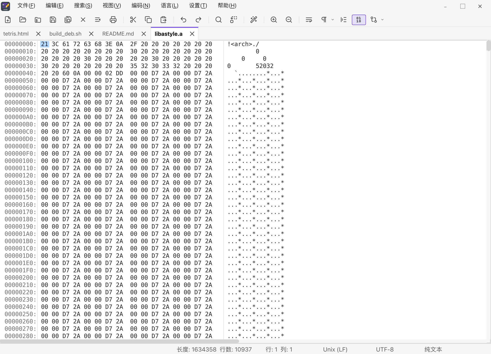
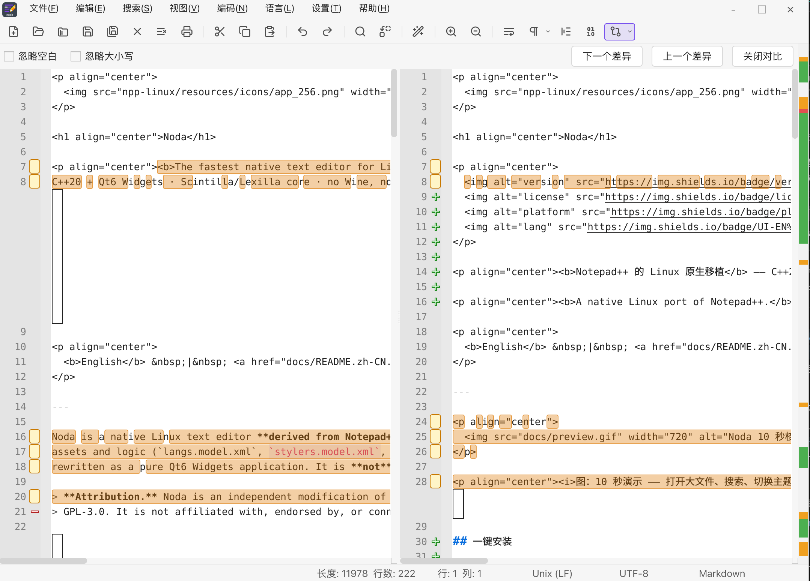
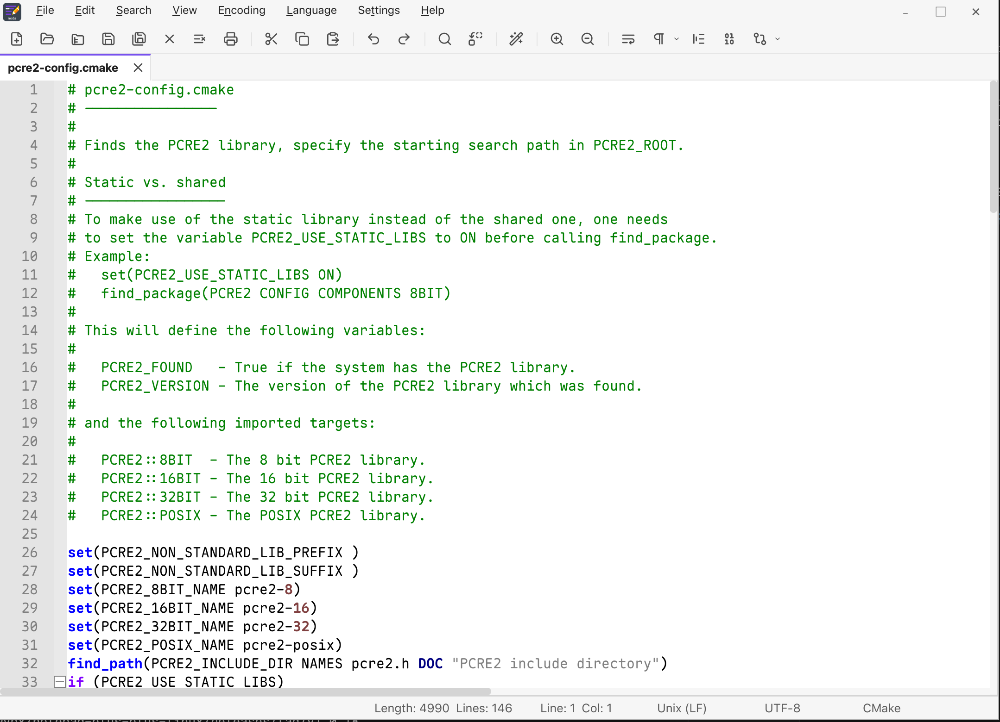
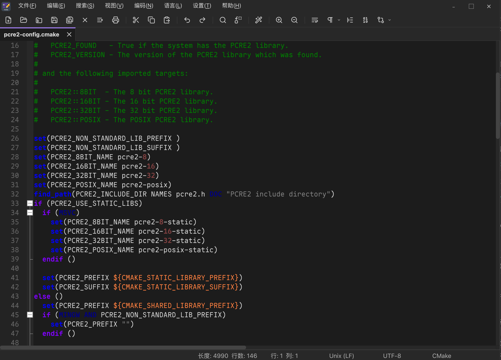

<p align="center">
  
</p>

<h1 align="center">Noda</h1>

<p align="center">
  
  
  
  
</p>

<p align="center"><b>A native Linux port of Notepad++.</b> C++20 + Qt6 Widgets · cold start ~80–120 ms · ~35–45 MB RSS · built-in hex view, folder workspace and a large-file diff engine.</p>

<p align="center">
  <b>English</b> &nbsp;|&nbsp; <a href="docs/README.zh-CN.md">Chinese</a>
</p>

---

## Screenshots

<p align="center">
  
  
</p>
<p align="center"><sub>Main editor · syntax highlighting / multi-tab &nbsp;·&nbsp; Preferences / Settings · tree categories, accent color</sub></p>

<p align="center">
  
  
</p>
<p align="center"><sub>Hex / binary viewer · true on-disk bytes &nbsp;·&nbsp; Document compare · large-file diff engine</sub></p>

<p align="center">
  
  
</p>
<p align="center"><sub>English interface · runtime EN ⇄ ZH switch &nbsp;·&nbsp; Dark mode · Obsidian-inspired light/dark tokens</sub></p>

## Install

**AppImage (recommended — no install, double-click to run, bundles the Qt6 runtime):**

```bash
# Download from Releases (replace OWNER/REPO with your actual Gitee repo path)
wget -O noda.AppImage https://gitee.com/OWNER/REPO/releases/download/v1.0.18/noda-x86_64.AppImage
chmod +x noda.AppImage && ./noda.AppImage
```

> Attach the AppImage as a Release asset when publishing; or generate it locally: `./npp-linux/build_appimage.sh`.

**Debian / Ubuntu (.deb):**

```bash
wget -O noda.deb https://gitee.com/OWNER/REPO/releases/download/v1.0.18/noda_*_amd64.deb
sudo apt install ./noda.deb
```

**Or build from source (about 1 minute):**

```bash
sudo apt update && sudo apt install -y build-essential cmake qt6-base-dev qt6-base-dev-tools libxcb1-dev
cd npp-linux && ./build.sh && ./build/noda
```

> One-click packaging of DEB + AppImage: `./npp-linux/build_package.sh` (add `--checksum` to also emit `SHA256SUMS`).

---

> **Attribution notice.** Noda is an independent modification of the Notepad++ source code, released under **GPL-3.0-or-later**. It is **not affiliated with, endorsed by, or connected to Notepad++ or its author**, and is not an official Notepad++ release. Upstream Notepad++ code is Copyright (C) 2021 Don HO. Third-party components (Scintilla / Lexilla / uchardet / pugixml / AStyle) retain their own licenses — see [`NOTICE`](NOTICE) and [`LICENSE`](LICENSE).

## How is Noda different from other editors?

Noda's selling point is not "yet another editor" — it is **bringing Notepad++'s operating habits and feature density to Linux as a truly native, lightweight, high-performance app that does not pile on features via plugins.**

| Dimension | **Noda** | Notepad++ | gedit | Kate | VSCode |
|---|:---:|:---:|:---:|:---:|:---:|
| Native Linux | ✓ Qt6 | ✗ Windows-only | ✓ GTK | ✓ KDE | ✗ Electron |
| Cold start | **~80–120 ms** | fast (Windows) | fast | medium | slow (~1s+) |
| Memory | **~35–45 MB** | low | low | medium-high | high (hundreds of MB) |
| Hex / binary view | ✓ built-in | ~ plugin | ✗ | ~ plugin | ✗ extension |
| Folder workspace | ✓ built-in | ~ plugin | ✗ | ✓ | ✓ |
| Document compare (large files) | ✓ built-in engine | ~ plugin | ✗ | ✓ | ✓ extension |
| Code formatting | ✓ AStyle / JSON | ~ plugin | ✗ | ~ plugin | ✓ extension |
| Bilingual UI (runtime switch) | ✓ | ~ multilingual | system | system | system |
| Accent color customization | ✓ | ~ | system | system | ✓ |
| Notepad++ habits | ✓ ported | ✓ | ✗ | ✗ | ✗ |

> Trade-off: Noda trades the plugin ecosystem for "built-in, zero-dependency, Linux-tuned" — common features work out of the box instead of being patched in via plugins or compatibility layers. If you need a huge extension marketplace, VSCode fits better; if you want **native, light, fast, Notepad++-like**, that's Noda.

## What Noda adds over Notepad++

Some features overlap with upstream; the point is that they are **built in, dependency-free,
and tuned for Linux** — not bolted on through plugins or a compatibility layer.

| Capability | Notepad++ (Windows) | Noda |
|---|---|---|
| Platform | Windows only | **Native Linux** (X11 + Wayland), `.deb`, `.AppImage`, `.desktop`, hicolor icons |
| Runtime | Win32 / GDI | **C++20 + Qt6 Widgets**, ~80–120 ms cold start, ~35–45 MB RSS |
| Binary / hex view | Via the HexEditor plugin | **Built-in raw-byte viewer** — `mmap`, viewport-only reads, no full-file copy, >4 GB–safe addresses |
| Folder workspace | "Folder as Workspace" | **Built-in dock** with lazy loading, zero recursive pre-scan, custom branch/indent painting |
| UI language | `nativeLang/*.xml` | **Runtime English ⇄ Chinese switch**, fully bilingual menus, tooltips and status bar |
| Theme | Built-in themes | **Obsidian-inspired light/dark tokens**, unified UI font (CJK + Latin), native borderless title bar |
| Code formatting | Plugins / external tools | **Built-in AStyle (C/C++/C#/Java/Obj-C) + JSON formatter**, runs off the UI thread |
| TypeScript | By lexer config | **`.ts` / `.tsx` highlighting** reusing the cpp lexer with correct properties |
| Session & backup | Periodic backup | **Session snapshot + auto backup**, unsaved content is restored with the caret position |

## Highlights

- **Performance-first engineering.** Viewport-only smart highlighting with a hard time budget,
  font-list and theme-metadata singletons, batched tab-bar re-polish, mmap-backed hex viewer,
  and no speculative dependencies.
- **A serious, modern UI.** Tree-structured preferences, editable shortcut mapper with conflict
  detection, style configurator (per language × style slot), and only real, backed toggles —
  no placeholder switches.
- **Linux-native integration.** X11 startup-notification fix-up, `%F` file associations,
  a `register_open_with.py` helper for the desktop context menu, and correct Wayland handling.
- **Clickable URLs.** URLs are underlined in the visible viewport and open in your default
  browser on `Ctrl` + click.
- **Binary files just work.** Files containing NUL bytes automatically open in the hex viewer,
  showing the true on-disk bytes — not the decoded text buffer.
- **A diff engine built for large files.** Histogram/Patience anchors + bounded Myers (no O(D²)
  memory), wyhash-style block hashing, real character-level intra-line ranges, moved-block
  detection, and async computation via `QtConcurrent` so the UI never freezes.
- **Comparison beyond two files.** Compare whole documents, selected blocks, or the current file
  against Git HEAD / SVN BASE (via `QProcess`, zero linked dependencies); click the difference
  mini-map to jump, and use the alignment-mapped scroll sync that stays correct even with
  placeholder lines.

## Core features

- [x] Multi-tab editing: new / open / save / save-as / save-copy-as, unsaved-change prompts,
      double-click empty tab bar to create a document.
- [x] Tab context menu: close / batch-close, save, rename, move to trash, reload, print,
      read-only, copy path, move tab, open containing folder.
- [x] Drag-and-drop files (multi-file) and command-line / IPC open.
- [x] Native Scintilla editing: undo/redo, cut/copy/paste, select-all, column selection.
- [x] Line numbers, fold margin, current-line highlight, word-wrap toggle.
- [x] Encoding detection (UTF-8 / GBK / Big5 / UTF-16 …) and EOL detection (LF / CRLF / CR).
- [x] Fast find & replace: match case, whole word, regex, replace-all.
- [x] External file-change monitoring via `inotify` with reload prompts.
- [x] Session memory + automatic backup of unsaved content.
- [x] Code formatting: AStyle for C-family, order-preserving JSON pretty-printer, worker thread.
- [x] Style configurator: per language × style slot colours, bold/italic, font family & size.
- [x] Preferences (tree): theme, UI language, tab bar, auto-completion, highlight matching,
      UI fonts, editor behaviour — only real, backed options.
- [x] Accent color: 7 presets (default purple, macOS blue, Ubuntu orange, GNOME blue, …)
      plus a custom color picker; applies to selection, links, highlights and tab bars.
- [x] Shortcut mapper generated from real menu actions; editable, conflict detection, reset.
- [x] Opening a folder: lazy, dependency-free directory tree in a left dock.
- [x] Built-in hexadecimal / binary viewer with raw on-disk bytes.
- [x] TypeScript / TSX syntax highlighting.
- [x] Side-by-side diff: whole files / selection / Git HEAD / SVN BASE / pick a file, moved blocks,
      intra-line character highlights, next/prev navigation (`F8` / `Shift+F8`), mini-map.
      The toolbar button is a dropdown toggle — click again to leave comparison mode (`Ctrl+Alt+X`).
- [x] Ignore whitespace / case / EOL options, runtime English ⇄ Chinese switching,
      one-time migration of legacy settings after the rename.

## Quick start (from source)

```bash
sudo apt update
sudo apt install -y build-essential cmake qt6-base-dev qt6-base-dev-tools

cd npp-linux
./build.sh
./build/noda
```

Package as a `.deb`:

```bash
cd npp-linux
./build_deb.sh
sudo apt install ./build-deb/noda_*_amd64.deb
```

Package as an **AppImage** (single file, no install):

```bash
cd npp-linux
./build_appimage.sh
chmod +x noda-*.AppImage && ./noda-*.AppImage
```

Toolbar and application icons are generated offline by `npp-linux/tools/*.py` and embedded as
Qt resources — a normal build needs no Python, no network and no system icon theme.

## Repository layout

This repository vendors every third-party source needed to build, so the directory layout is
**load-bearing**: `npp-linux/CMakeLists.txt` resolves dependencies via `NPP_ROOT = ..`.

| Path | Origin | Purpose |
|---|---|---|
| `npp-linux/` | Noda | Application: windows, editor wrapper, dialogs, theme and icon tooling |
| `scintilla/` | Upstream (vendored) | Editing engine (buffer, selection, undo, rendering) |
| `lexilla/` | Upstream (vendored) | Lexer engine and per-language lexers |
| `PowerEditor/src/uchardet/` | Upstream (vendored) | Charset auto-detection |
| `PowerEditor/src/pugixml/` | Upstream (vendored) | XML parsing for language/style models |
| `PowerEditor/src/langs.model.xml`<br>`PowerEditor/src/stylers.model.xml` | Upstream (vendored) | Language and theme definitions, reused verbatim |

## Documentation

- Chinese product guide: **[docs/README.zh-CN.md](docs/README.zh-CN.md)**
- Contributing (English): **[CONTRIBUTING.md](CONTRIBUTING.md)** — includes `good first issue` entry-level tasks
- Contributing (Chinese): **[docs/CONTRIBUTING.zh-CN.md](docs/CONTRIBUTING.zh-CN.md)**
- Changelog: **[CHANGELOG.md](CHANGELOG.md)**

## Contributing

PRs are welcome. Please read **[CONTRIBUTING.md](CONTRIBUTING.md)** first — it covers local
build, the TDD development rules, and the `good first issue` entry-level tasks. Features that
can't meet the performance bar are better left undone.

## License

- Noda is released under the **GNU General Public License v3.0-or-later (GPL-3.0-or-later)** —
  see [`LICENSE`](LICENSE) (`SPDX-License-Identifier: GPL-3.0-or-later`).
- A summary of third-party component licenses is in [`NOTICE`](NOTICE): `scintilla/` and
  `lexilla/` are under Neil Hodgson's permissive license; `PowerEditor/src/uchardet/` is
  MPL 1.1 / GPL 2.0 / LGPL 2.1 (tri-license); `PowerEditor/src/pugixml/` is MIT;
  `third_party/astyle/` is LGPL-3.0.

Noda is an independent project. It is not affiliated with, endorsed by, or connected to Notepad++
or its author, and it is not an official release of the Notepad++ project.
